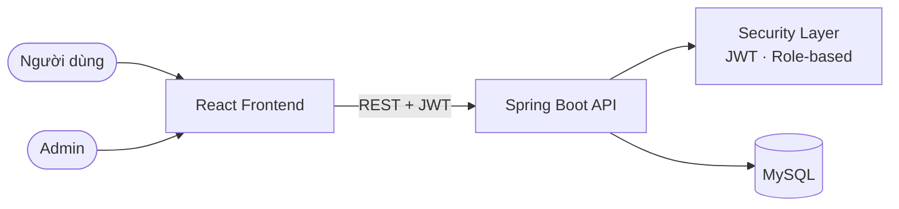
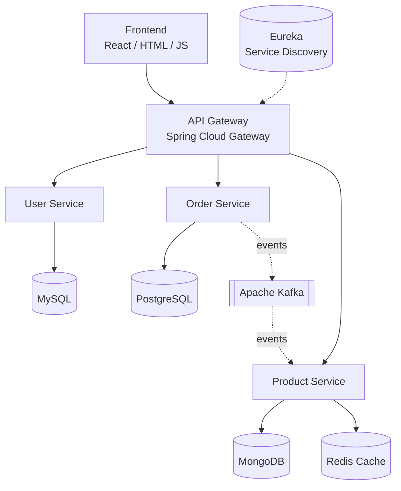

  <picture>
    <source media="(prefers-color-scheme: dark)" srcset="https://capsule-render.vercel.app/api?type=waving&color=0:0F2027,100:2C5364&height=200&section=header&text=Đặng%20Thanh%20Bình&fontSize=44&fontColor=ffffff&animation=fadeIn&fontAlignY=38&desc=Backend%20%2F%20Fullstack%20Developer&descSize=18&descAlignY=58" />
    <source media="(prefers-color-scheme: light)" srcset="https://capsule-render.vercel.app/api?type=waving&color=0:232526,100:414345&height=200&section=header&text=Đặng%20Thanh%20Bình&fontSize=44&fontColor=ffffff&animation=fadeIn&fontAlignY=38&desc=Backend%20%2F%20Fullstack%20Developer&descSize=18&descAlignY=58" />
    
  </picture>

<h1 align="center">Xin chào, mình là Đặng Thanh Bình 👋</h1>

  <b>Software Engineering Student · Backend / Fullstack Developer · AI &amp; Microservices Enthusiast</b>

  
  
  
  

  

  <a href="#-giới-thiệu">Giới thiệu</a> ·
  <a href="#-tech-stack">Tech Stack</a> ·
  <a href="#-dự-án-nổi-bật">Dự án</a> ·
  <a href="#-định-hướng-kiến-trúc">Kiến trúc</a> ·
  <a href="#-ai--modern-backend">AI</a> ·
  <a href="#-lộ-trình-học-tập">Lộ trình</a> ·
  <a href="#-github-stats">Stats</a> ·
  <a href="#-liên-hệ">Liên hệ</a>

---

## 🧑‍💻 Giới thiệu

Mình là sinh viên ngành Công nghệ phần mềm / Công nghệ thông tin, tập trung vào **phát triển backend** với hệ sinh thái **Java – Spring**. Mình yêu thích việc thiết kế những hệ thống có cấu trúc rõ ràng, dễ mở rộng, dễ bảo trì, đặc biệt là kiến trúc **Microservices** và các ứng dụng tích hợp **AI** (RAG, Tool Calling, AI Agents).

> *"Tương lai sẽ quyết định."*

| | |
| :-- | :-- |
| 🎓 **Học vấn** | Sinh viên Software Engineering / Information Technology |
| 💼 **Định hướng** | Backend Developer → Fullstack → AI-integrated Backend |
| ☕ **Ngôn ngữ chính** | Java |
| 🌱 **Đang học** | Spring Boot · Spring Cloud · Kafka · Spring AI |
| 🤖 **Quan tâm** | RAG · Tool Calling · MCP · AI Agents · Observability |
| 🐳 **DevOps** | Docker · Docker Compose · Git · CI/CD |
| 📍 **Địa điểm** | Hà Nội, Việt Nam |
| 🌐 **Ngôn ngữ giao tiếp** | Tiếng Việt, tiếng Anh (đọc hiểu tài liệu kỹ thuật) |

### 🎯 Mục tiêu hiện tại

- Nắm vững **Spring ecosystem** và các nguyên tắc thiết kế API chuẩn REST.
- Hiểu sâu về **distributed systems**: service discovery, API gateway, messaging, xử lý bất đồng bộ.
- Xây dựng ứng dụng **AI-powered** có thể đưa vào thực tế: RAG, memory, tool calling, observability.
- Phát triển theo hướng **cloud-native**: container hóa, tự động hóa build/deploy.

### 📐 Tiêu chuẩn kỹ thuật mình hướng tới

- Kiến trúc phân lớp rõ ràng (Controller → Service → Repository), tách biệt DTO và Entity.
- RESTful API, validate dữ liệu đầu vào, xử lý lỗi thống nhất.
- Bảo mật cơ bản: JWT, phân quyền theo vai trò, mã hóa mật khẩu.
- Commit theo [Conventional Commits](https://www.conventionalcommits.org/), quy trình nhánh rõ ràng.
- Đóng gói bằng Docker, môi trường chạy nhất quán giữa dev và production.

---

## 🛠️ Tech Stack

| Nhóm | Công nghệ |
| :-- | :-- |
| **Ngôn ngữ** |  |
| **Backend & Framework** |  |
| **Frontend** |  |
| **Database & Cache** |  |
| **Messaging** |  |
| **DevOps & Tools** |  |

**AI & Modern Backend**

  
  
  
  
  
  

---

## 🚀 Dự án nổi bật

### 🛒 E-Commerce Platform

Hệ thống thương mại điện tử **fullstack**, gồm giao diện người dùng, API backend và trang quản trị. Dự án giúp mình thực hành toàn bộ vòng đời của một ứng dụng web: thiết kế database, xây dựng REST API, bảo mật bằng JWT, xây giao diện React và đóng gói bằng Docker.

  

<!-- Thêm nút Source Code tại đây: <a href="https://github.com/binhptit2810/<ten-repo>">...</a> -->

  

**Công nghệ sử dụng**

**Tính năng chính**

| Phân hệ | Chức năng |
| :-- | :-- |
| 🔐 **Xác thực & phân quyền** | Đăng ký, đăng nhập, bảo mật API bằng JWT, phân quyền User / Admin |
| 👤 **Người dùng** | Quản lý tài khoản và thông tin cá nhân |
| 📦 **Sản phẩm** | Quản lý sản phẩm và danh mục, hiển thị danh sách và chi tiết |
| 🛒 **Giỏ hàng** | Thêm, sửa, xóa sản phẩm trong giỏ |
| 🧾 **Đơn hàng** | Đặt hàng, xem lịch sử, theo dõi trạng thái giao hàng |
| 🛡️ **Admin dashboard** | Quản trị sản phẩm, đơn hàng và người dùng |
| 📱 **Giao diện** | Responsive, tương thích desktop và mobile |

<b>🏗️ Kiến trúc tổng quan của dự án</b>

 

---

## 🧭 Định hướng kiến trúc

Kiến trúc **Microservices** mà mình đang học và xây dựng, kết hợp Spring Cloud và message broker:

---

## 🤖 AI & Modern Backend

Mình đang tìm hiểu cách đưa AI vào hệ thống backend một cách bài bản, thay vì chỉ gọi API của mô hình.

| Lĩnh vực | Công nghệ | Mục tiêu học tập |
| :-- | :-- | :-- |
| ☕ **Backend** | Java, Spring Boot | Nền tảng xây dựng REST API và service layer |
| 🌐 **Microservices** | Spring Cloud, Eureka, API Gateway | Tách service, định tuyến, service discovery |
| 📨 **Messaging** | Apache Kafka | Giao tiếp bất đồng bộ giữa các service |
| 🤖 **AI** | Spring AI, LLM, Tool Calling | Tích hợp mô hình ngôn ngữ và gọi hàm từ AI |
| 📚 **RAG** | Vector DB, pgvector, Embeddings | Truy xuất tri thức riêng để câu trả lời chính xác hơn |
| 🔌 **AI Integration** | MCP, AI Agents | Kết nối AI với công cụ và nguồn dữ liệu bên ngoài |
| 🧠 **Memory** | Chat Memory, Conversation Context | Duy trì ngữ cảnh hội thoại nhiều lượt |
| 📊 **Observability** | Langfuse | Theo dõi, đánh giá và gỡ lỗi luồng gọi LLM |
| 🐳 **DevOps** | Docker, Docker Compose | Chạy toàn bộ hệ thống bằng một lệnh |
| 🗄️ **Database** | MySQL, PostgreSQL, MongoDB, Redis | Chọn đúng loại lưu trữ cho đúng bài toán |

---

## 🗺️ Lộ trình học tập

- [x] Java core, OOP, Collections, Stream API
- [x] Spring Boot: REST API, JPA/Hibernate, Spring Security + JWT
- [x] Docker cơ bản, Git workflow
- [ ] Spring Cloud: Gateway, Eureka, OpenFeign
- [ ] Apache Kafka: producer, consumer, event-driven design
- [ ] Spring AI: chat model, prompt, tool calling
- [ ] RAG với pgvector và embeddings
- [ ] MCP và AI Agents
- [ ] Observability với Langfuse
- [ ] CI/CD và triển khai lên cloud

---

## 📊 GitHub Stats

  <picture>
    <source media="(prefers-color-scheme: dark)" srcset="https://github-readme-stats.vercel.app/api?username=binhptit2810&show_icons=true&hide_border=true&theme=dark&bg_color=00000000&rank_icon=github" />
    
  </picture>
  <picture>
    <source media="(prefers-color-scheme: dark)" srcset="https://github-readme-stats.vercel.app/api/top-langs/?username=binhptit2810&layout=compact&hide_border=true&theme=dark&bg_color=00000000" />
    
  </picture>

  <picture>
    <source media="(prefers-color-scheme: dark)" srcset="https://streak-stats.demolab.com?user=binhptit2810&theme=dark&hide_border=true&background=00000000" />
    
  </picture>

<b>🏆 Thành tích &amp; hoạt động đóng góp</b>

 

  

  

---

## 📫 Liên hệ

Mình luôn sẵn sàng trao đổi về backend, microservices, AI hoặc cơ hội học tập và làm việc cùng nhau.

| Kênh | Liên kết |
| :-- | :-- |
| 📧 Email | [binhptit2810@gmail.com](mailto:binhptit2810@gmail.com) |
| 💻 GitHub | [github.com/binhptit2810](https://github.com/binhptit2810) |
| 📸 Instagram | [@binhptit2810](https://www.instagram.com/binhptit2810/) |
| 👥 Facebook | [facebook.com/binhptit2810](https://facebook.com/binhptit2810) |

---

  

  <i>💡 Building today. Learning every day. 🚀</i>

  <picture>
    <source media="(prefers-color-scheme: dark)" srcset="https://capsule-render.vercel.app/api?type=waving&color=0:2C5364,100:0F2027&height=100&section=footer" />
    <source media="(prefers-color-scheme: light)" srcset="https://capsule-render.vercel.app/api?type=waving&color=0:414345,100:232526&height=100&section=footer" />
    
  </picture>

